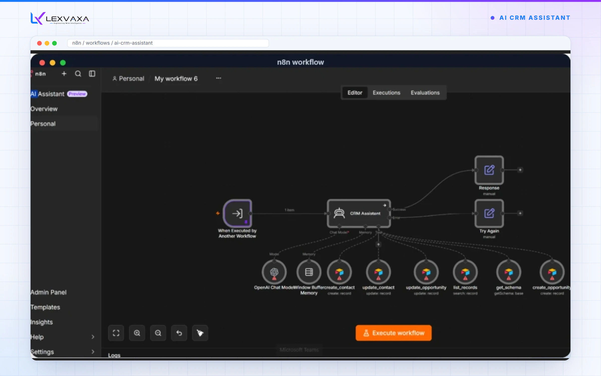

<!-- styled:v2 -->

**A conversational AI assistant that searches, creates and updates CRM contacts and opportunities in Airtable, with safe success and retry paths.**

  
  
  
  
  
  
  

  <a href="#overview">Overview</a> ·
  <a href="#key-features">Key features</a> ·
  <a href="#results">Results</a> ·
  <a href="#tech-stack">Tech stack</a>

---

## Overview

Connecting conversational AI to many CRM actions risked a messy, fragile workflow. Lexvaxa built a modular CRM automation in n8n with an OpenAI chat model, memory and Airtable. The assistant searches and retrieves CRM records, creates and updates contacts and opportunities, and follows clear success, error and retry paths, so the team can talk to its CRM in plain language. Screens shown use sample data, so no client records are exposed.

## The challenge

Every new CRM action made the AI workflow harder to maintain and easier to break.

## The solution

A modular n8n agent with an OpenAI chat model, memory and separate Airtable tools for each action, plus success, error and retry paths.

## Key features

- Search and retrieve CRM records
- Create and update contacts and opportunities
- Success, error and retry paths
- AI-assisted CRM conversations
- Modular tools that are easy to extend

## Results

- A structured, maintainable AI agent for CRM operations that the team can extend safely

## Tech stack

    

## Privacy

Client names and records are confidential. Every screen in this repository uses sample data, and source code that belongs to the client is not published.

## Links

- Case study on Lexvaxa: https://lexvaxa.com/work/ai-crm-assistant-airtable

---

**Built by [Ch Muhammad Samiullah](https://github.com/samiullah156-creator)** · AI Automation Engineer and Full-Stack Developer at [Lexvaxa](https://lexvaxa.com)

⭐ Star this repo if you found it useful

